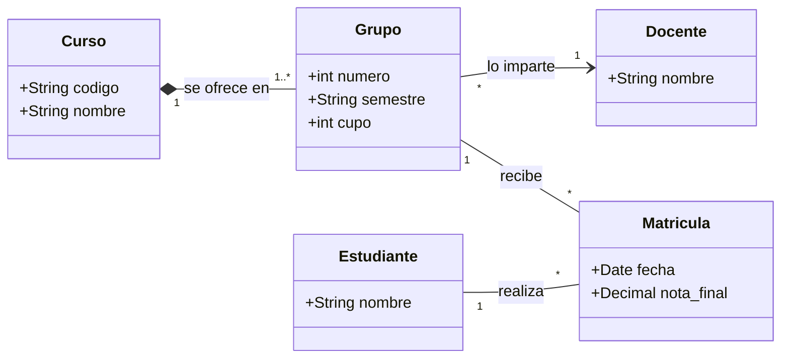
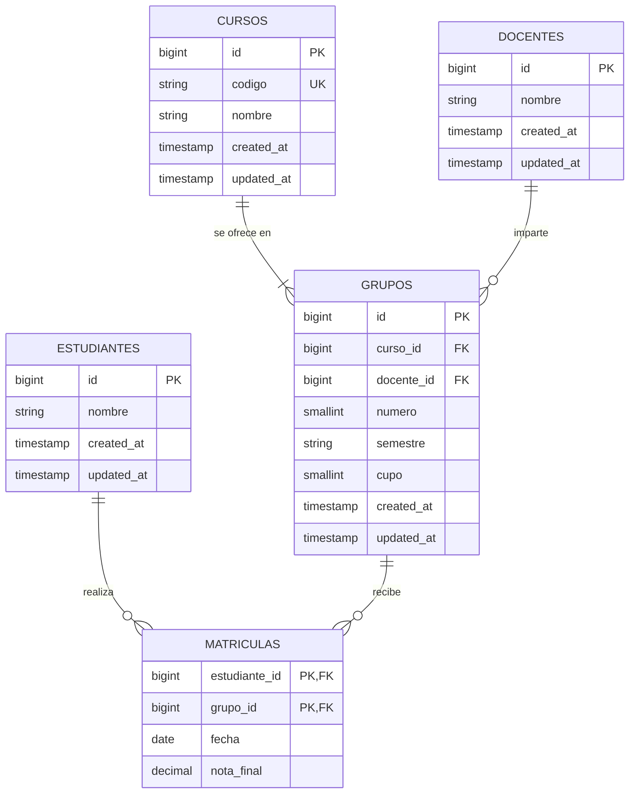

# Actividad: Modelo universitario (Laravel)

Curso, Grupo, Docente, Estudiante y Matrícula, con Laravel 12, Eloquent y Pest.

## Diagrama de clases



## Tablas resultantes



## Preguntas de control

**¿Qué relación es composición y por qué?**
Curso ◆── Grupo. El grupo no existe sin su curso: `curso_id` es obligatorio y, si se borra el curso, sus grupos se borran con él (`cascadeOnDelete`). Docente y Estudiante existen por sí mismos, por eso sus relaciones son asociaciones simples.

**¿Qué asociación es unidireccional?**
Grupo ──▶ Docente. El grupo conoce a su docente (`belongsTo`), pero el docente no sabe qué grupos tiene, así que `Docente` no tiene método `grupos()`.

**¿Dónde vive la nota?**
En `Matricula`, la clase de asociación entre Estudiante y Grupo. La nota depende del par estudiante-grupo, no de uno solo. En la base de datos es la columna `nota_final` de la tabla `matriculas`.

## Ejecutar el proyecto

```bash
composer install
cp .env.example .env
php artisan key:generate
php artisan test
```