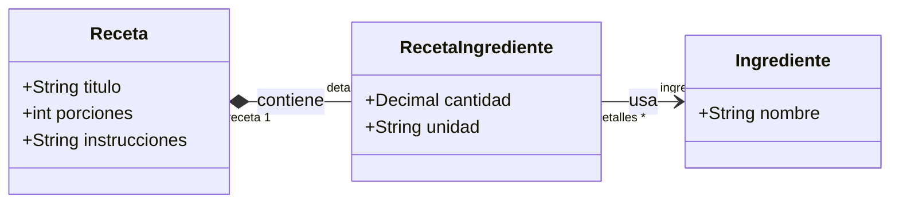
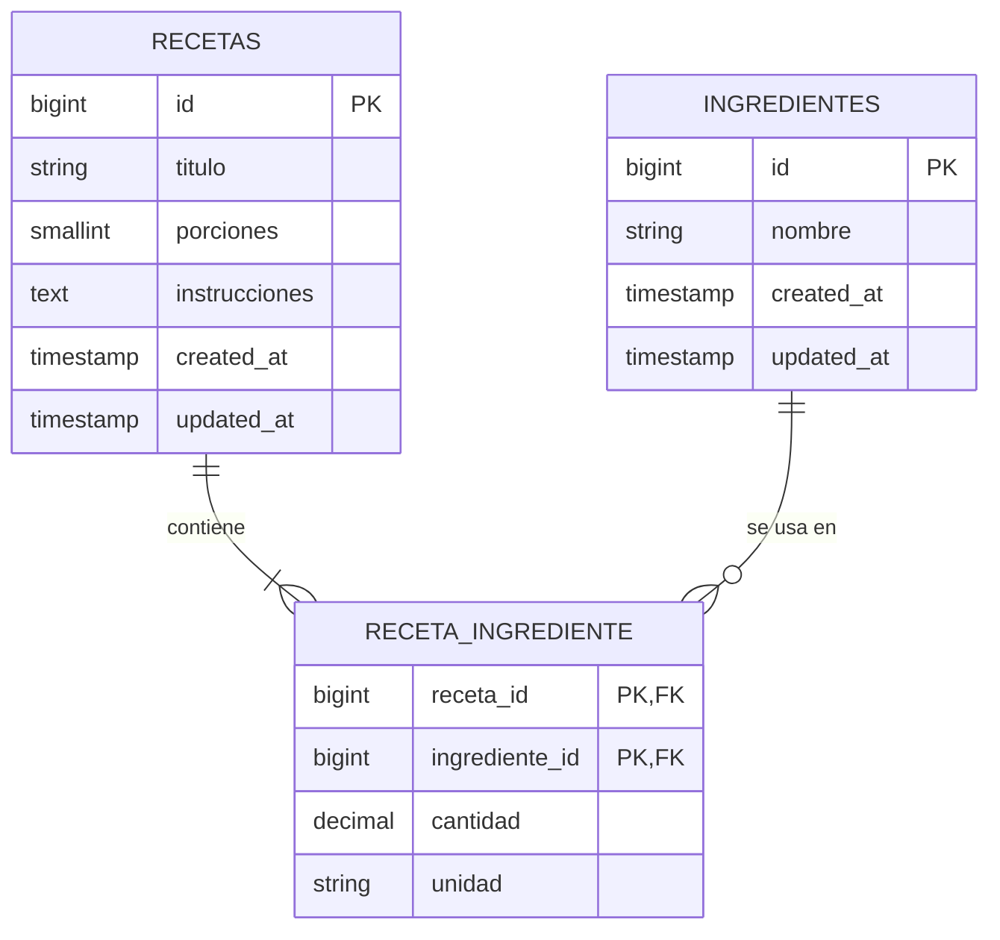
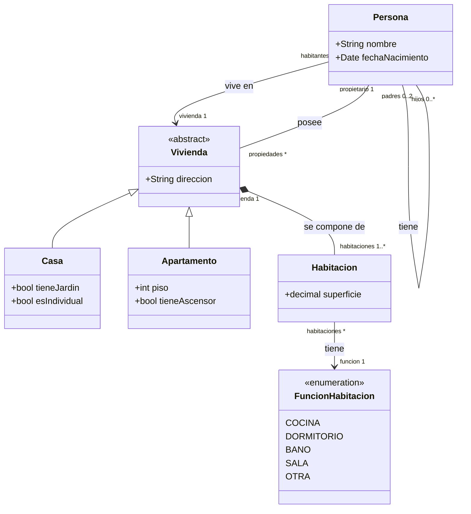

# Actividad 14

## Ejercicio 4: Receta e ingredientes

Una receta tiene título, porciones e instrucciones, y contiene de uno a muchos ingredientes. De cada ingrediente de la receta se guarda la cantidad y la unidad de medida.

### Diagrama de clases

`RecetaIngrediente` es la clase de asociación: guarda la cantidad y la unidad de cada ingrediente dentro de una receta. Un ingrediente puede aparecer en varias recetas.

### Código
- Instanciación de `Receta`: `new Receta([...])` seguido de `save()`, en `tests/Feature/RecetaTest.php`
- Modelos: `app/Models/Receta.php`, `app/Models/Ingrediente.php`, `app/Models/RecetaIngrediente.php`
- Migraciones: `database/migrations/2026_10_22_00000*_create_*`
- Instanciación de `Receta`: `tests/Feature/RecetaTest.php`

### Diagrama entidad-relación

## Ejercicio 5: Propiedades

### Diagrama de clases

