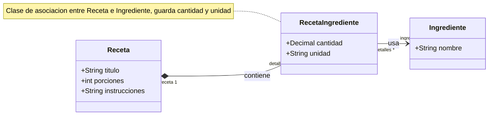
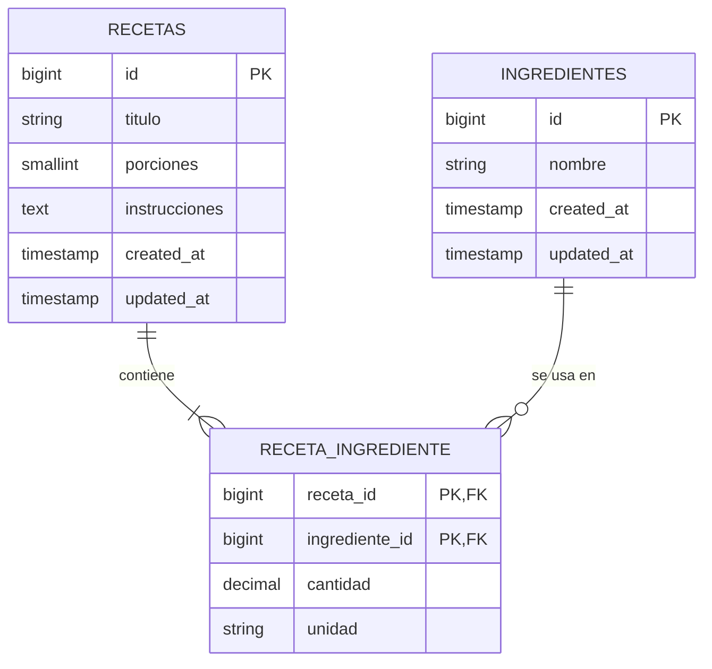
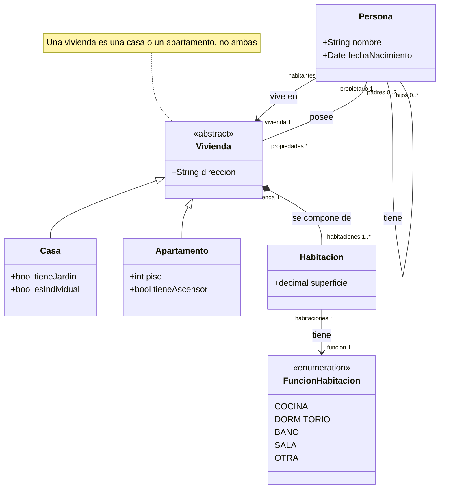

# Actividad 14

## Ejercicio 4: Asociaciones clase (Receta e ingredientes)

Una receta tiene título, porciones e instrucciones, y contiene de uno a muchos ingredientes. De cada ingrediente relacionado con la receta se necesita la cantidad a usar y la unidad de medida.

### 1. Diagrama de clases



**Supuestos**

- `RecetaIngrediente` es la clase de asociación entre `Receta` e `Ingrediente`. Mermaid no dibuja la línea punteada de UML, por eso se indica con una nota.
- Un ingrediente puede aparecer en varias recetas, por eso se modela como clase aparte.
- La multiplicidad `1..*` está declarada en el diagrama. El código no impide guardar una receta sin ingredientes.
- La unidad de medida se guarda como texto.

### 2. Código

- Modelos: `app/Models/Receta.php`, `app/Models/Ingrediente.php`, `app/Models/RecetaIngrediente.php`
- Migraciones: `database/migrations/2026_10_22_00000*_create_*`
- Instanciación de `Receta`: `tests/Feature/RecetaTest.php`

### 3. Instanciar la clase Receta

```php
$receta = new Receta([
    'titulo' => 'Panqueques',
    'porciones' => 4,
    'instrucciones' => 'Mezclar todo y cocinar en sartén.',
]);
$receta->save();

$harina = new Ingrediente(['nombre' => 'Harina']);
$harina->save();

$receta->ingredientes()->attach($harina->id, ['cantidad' => 200, 'unidad' => 'g']);
```

Se ejecuta como prueba con `php artisan test` (archivo `tests/Feature/RecetaTest.php`).

### 4. Diagrama entidad-relación



## Ejercicio 5: Propiedades

Una persona tiene nombre y fecha de nacimiento, puede tener cónyuge y varios hijos, vive en una vivienda (casa o apartamento) y puede poseer varias propiedades. Las viviendas tienen dirección y se componen de habitaciones con superficie y función. Las casas pueden tener jardín y ser individuales. Los apartamentos están en un piso y algunos tienen ascensor. Cada vivienda pertenece a un propietario.

### 1. Diagrama de clases



**Supuestos**

- Las "propiedades" de una persona son sus viviendas, y cada vivienda tiene exactamente un propietario.
- Una vivienda es una casa o un apartamento, nunca las dos cosas.
- La flecha "vive en" va de `Persona` a `Vivienda`: la persona conoce su vivienda. El enunciado no dice si la vivienda conoce a sus habitantes.
- Las habitaciones son composición: no existen sin su vivienda.
- La función de la habitación (cocina, dormitorio, etc.) se modela como enumeración.
